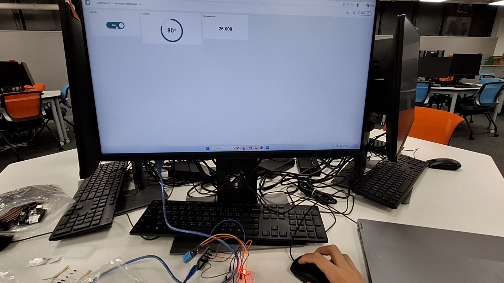

# Arduino-IoT-Cloud
This repository is about the connectivity between NodeMCU-ESP8266 with the Arduino Cloud IoT and DHT11.

## Objective:

In this tutorial, we will practice the process of configuring the NodeMCU-ESP8266 with the
Arduino Cloud IoT. To validate the setup, we will transmit DHT11 sensor data from the board
to the cloud and establish a switch that can manipulate the LED connected to the NodeMCU.

